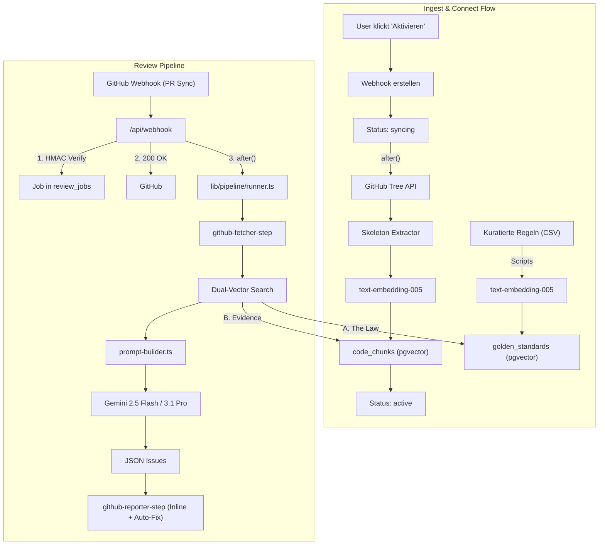

# 🛡️ Anti-AI-Slop Gatekeeper — Projektstatus (MVP v1.0)

> **Übersicht**
> 
> Ein B2B SaaS namens **"Anti-AI-Slop Gatekeeper"**, das Code-Reviews für Pull-Requests automatisiert. Es nimmt GitHub-Webhooks entgegen, analysiert Code via Google Vertex AI (Gemini 2.5 Flash, bald 3.1 Pro) auf AI-generierten "Slop" und postet direkt im PR Inline-Comments sowie automatische Fix-Vorschläge.

Durch die neue **Hybrid RAG Architektur** ("The Judge Pattern") handelt das System wie ein aktiver Engineering Manager:
- Es setzt **"The Law"** (kuratierte Golden Standards, importiert aus CSV) als absolute Regeln durch.
- Es nutzt **"Evidence"** (Skeleton Ingestion des lokalen User-Repos) zur Vermeidung von DRY-Violations, ohne lokale Anti-Patterns zu adaptieren.

*Alles DSGVO-konform in der EU gehostet.*

---

## 🏗️ Infrastruktur (Live & Getestet ✅)

| **Service** | **Region** | **Status** |
| --- | --- | --- |
| **Vercel** | `fra1` (Frankfurt) | ✅ Region-Pinning via `vercel.json` |
| **Supabase** | `eu-central-1` (Frankfurt) | ✅ pgvector aktiviert, Tabellen live, Ingest erfolgreich |
| **Google Vertex AI** | `europe-west3` (Frankfurt) | ✅ Verbunden, `gemini-2.5-flash` & `text-embedding-005` |
| **Async Job Queue** | Supabase + `after()` | ✅ Vollständig funktionsfähig |

---

## 🔄 Architektur-Flow (Getestet ✅)

*(Architektur wurde kürzlich refactored, um eine modulare Pipeline in `src/lib/pipeline` zu nutzen)*



> **Hinweis zur Queue:** Keine externen Queue-Services nötig. Next.js `after()` aus `next/server` führt Code nach dem Response aus. Die Serverless-Function bleibt bis `maxDuration` am Leben (Hobby: 10s, Pro: 300s).

---

## 🛠️ Tech Stack

- **Framework:** Next.js 16.2.4 (App Router, TypeScript, Tailwind v4)
- **AI:** Google Vertex AI via `@google/genai` SDK (`gemini-2.5-flash` / `gemini-3.1-pro`, `text-embedding-005`)
- **Datenbank:** Supabase mit `pgvector` (für Dual-RAG)
- **Queue:** Supabase `review_jobs` Tabelle + Next.js `after()` API
- **Hosting:** Vercel (Frankfurt `fra1`) — *derzeit Hobby-Plan, Pro für Go-Live*
- **Node.js:** v22.14.0

---

## 📂 Projekt-Struktur

```text
c:\dev\unslop\
├── vercel.json                          # Region-Pinning auf fra1
├── package.json                         # Dependencies (inkl. csv-parse)
├── .env.local                           # Secrets (NICHT committen!)
├── scripts/
│   └── ingest-golden-standards.ts       # CSV Vektor-Ingest Skript (Abgeschlossen ✅)
│
├── supabase/
│   └── migrations/
│       ├── ... (SQL Migrations für Tabellen & Vektoren)
│
└── src/
    ├── lib/
    │   ├── pipeline/                    # ✅ NEU: Modulare Review Pipeline
    │   │   ├── runner.ts                # Führt Steps sequenziell aus
    │   │   ├── prompt-builder.ts        # Dynamischer Prompt Builder
    │   │   └── steps/                   # z.B. github-reporter-step.ts
    │   ├── vertex.ts                    # Vertex AI Auth via ADC
    │   ├── github.ts                    # GitHub API (Webhooks, PRs, Comments)
    │   ├── crypto.ts                    # AES-256-GCM Verschlüsselung für Tokens
    │   ├── rag.ts                       # Dual-Vector-Search Pipeline
    │   ├── embeddings.ts                # Batch-Embedding via text-embedding-005
    │   └── skeleton.ts                  # Regex-basierte Skeleton Extraction
    │
    └── app/
        ├── dashboard/                   # UI für Repo-Verwaltung (Connect/Disconnect)
        ├── api/
            ├── webhook/route.ts         # GitHub PR Webhook Entry-Point + HMAC Verify
            ├── repos/connect/route.ts   # Erstellt Webhook + trigger Ingestion via after()
            └── test/route.ts            # System Health-Check
```

---

## 🧩 Kern-Komponenten & Dateien

### `src/lib/vertex.ts` — Vertex AI Client
**Auth-Pattern:** Base64 Service-Account-Key → temp JSON-Datei → `GOOGLE_APPLICATION_CREDENTIALS`. Das `@google/genai` SDK akzeptiert KEINE inline-Credentials für Vertex AI, es MUSS ADC (Application Default Credentials) sein.

### `src/lib/github.ts` & `src/lib/crypto.ts` — Sicherheit & GitHub
User-Tokens werden **AES-256-GCM verschlüsselt** in Supabase gespeichert. Webhooks werden mit kryptographischen HMAC-Secrets gesichert.

### `scripts/ingest-golden-standards.ts` — Golden Database Ingest ✅
Das Skript nutzt `csv-parse`, um die kuratierte `Golden_Database__-_Tabellenblatt1.csv` einzulesen.

### `src/lib/pipeline` — Modulare Architektur ✅
Die ursprünglich monolithische Logik in `worker.ts` wurde kürzlich durch eine strikte Pipeline-Architektur abgelöst. Der `runner.ts` verarbeitet Steps wie Fetching, RAG-Abfragen, Prompt-Generierung und GitHub-Reporting (`github-reporter-step.ts`) nun komplett modular.

### `src/lib/skeleton.ts` & `src/lib/embeddings.ts` — Ingestion
Verhindert "Shit-in-Shit-out" durch Regex-basierte **Skeleton-Extraction**. Neu hinzugekommen ist eine Soft-Delete und Delta-Ingestion Mechanik für Code Chunks (Updates via Repositories).

---

## 🗄️ Supabase Tabellen (Alle Live ✅)

| **Tabelle** | **Zweck** |
| --- | --- |
| `review_jobs` | Status und Payload der Async Queue (pending → processing → done) |
| `repositories` | Verwaltet GitHub Repos. **Features:** Soft-Delete & Realtime Updates |
| `github_tokens` | Speichert AES-256-GCM verschlüsselte GitHub Tokens der User |
| `golden_standards` | `pgvector` HNSW-Index. Speichert kuratierte Best-Practices ("The Law") |
| `code_chunks` | `pgvector` HNSW-Index. Speichert Skeletons des User-Repos ("Evidence") |

---

## 🚀 Was noch fehlt & Ideen für das MVP

- [x] **Golden Standards befüllen:** ✅ Abgeschlossen.
- [x] **GitHub PR Commenting:** ✅ Abgeschlossen. Der API-Call postet das Review als echte Inline-Comments im Diff (`github-reporter-step.ts`).
- [x] **Der Auto-Fixer (Code Suggestion):** ✅ Abgeschlossen. Fix-Vorschläge werden als 1-Click ````suggestion```` Blöcke direkt in den GitHub-Kommentaren gepostet.
- [x] **Pipeline Refactoring:** ✅ Abgeschlossen. Modulare Pipeline mit `prompt-builder.ts` und Condition-Registry.
- [x] **Soft-Delete & Delta-Ingestion:** ✅ Abgeschlossen. Repos und Code Chunks unterstützen nun Soft-Deletes mit pg_cron Cleanup.
- [ ] **Dashboard komplett überarbeiten:** Das gesamte Dashboard muss neu designt werden. Die 1-Click Auto-Fixes müssen direkt über die Dashboard-UI ausführbar sein.
- [ ] **App-Store Submission:** GitHub App für das Produkt registrieren, um Enterprise-Repos bedienen zu können (aktuell OAuth basiert).
- [ ] **Vercel Pro Upgrade:** Für den Go-Live zwingend erforderlich (Erhöhung der `maxDuration` von 10s auf 300s für den Worker).

---

## ⚠️ Bekannte Gotchas

- **Model-Versionen:** Wir nutzen aktuell **`gemini-2.5-flash`** und schwenken später auf **`gemini-3.1-pro`**.
- **`after()` Timeout:** Serverless-Timeouts auf Hobby-Plans (10s) können die Skeleton-Ingestion abbrechen.
- **Supabase Dashboard "Unhealthy":** Kann ignoriert oder durch "Restart Project" behoben werden.
